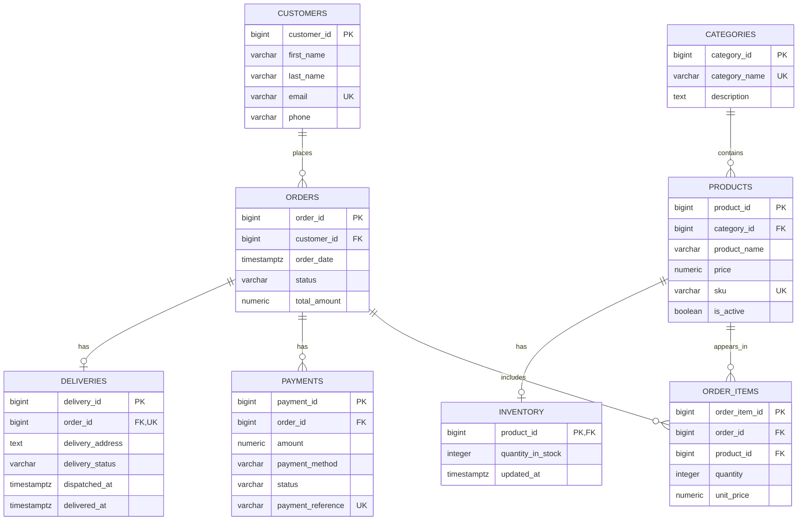

# NaijaMart Entity-Relationship Diagram

This diagram represents the eight tables implemented in the NaijaMart PostgreSQL database and their relationships.

**Constraint note:** The `order_items` table has a composite unique constraint on (`order_id`, `product_id`). This prevents the same product from appearing in multiple order-item rows for the same order. Neither column is independently unique.
