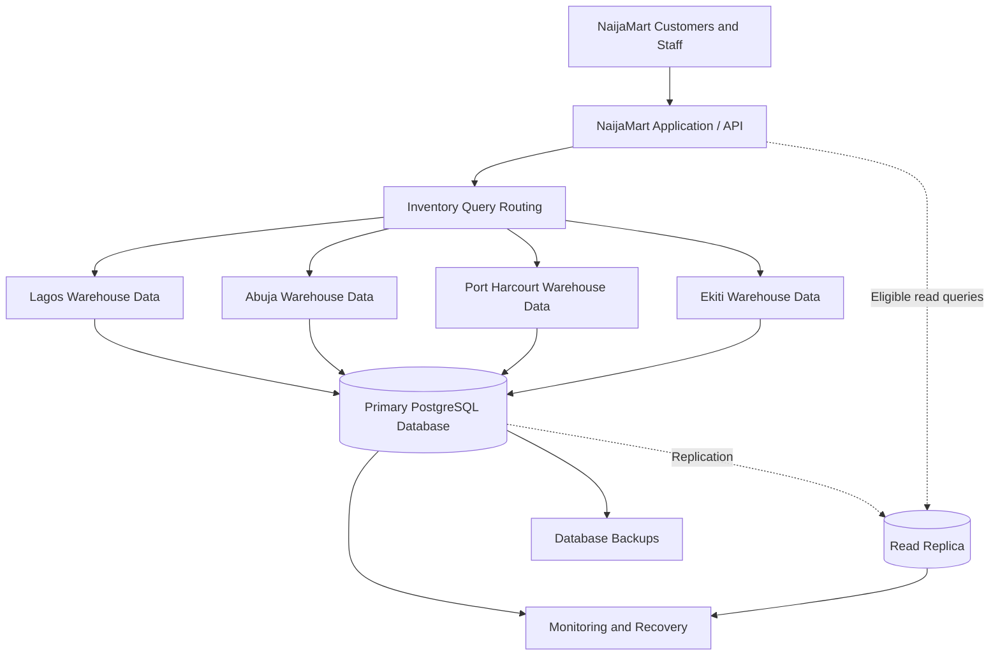

# NaijaMart Distributed Database Architecture

**Status:** Conceptual architecture — not deployed.

## Proposed architecture

## Component descriptions

- **Application/API:** Receives customer and staff requests.
- **Query routing:** Represents application logic for locating warehouse inventory.
- **Warehouse data:** Represents four logical warehouse allocations stored in the current database.
- **Primary PostgreSQL database:** The database used for this exercise.
- **Read replica:** A proposed replicated database for eligible read queries; not deployed.
- **Backups and monitoring:** Proposed operational components; not configured.

## Current implementation

PostgreSQL 18 runs on one local server. The implementation contains four warehouses and 16 warehouse inventory records. Inventory totals match the original quantities for all four products.

## Limitations

This diagram presents a proposed architecture, not a deployed distributed system. Separate warehouse database servers, actual data sharding, replication, automatic failover, and cloud database deployment have not been implemented.
